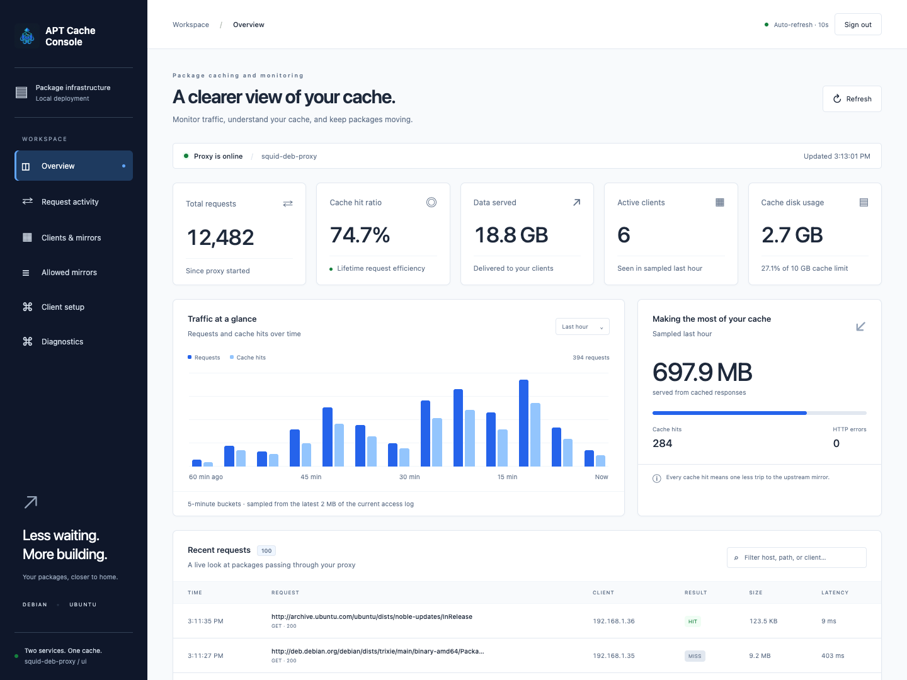
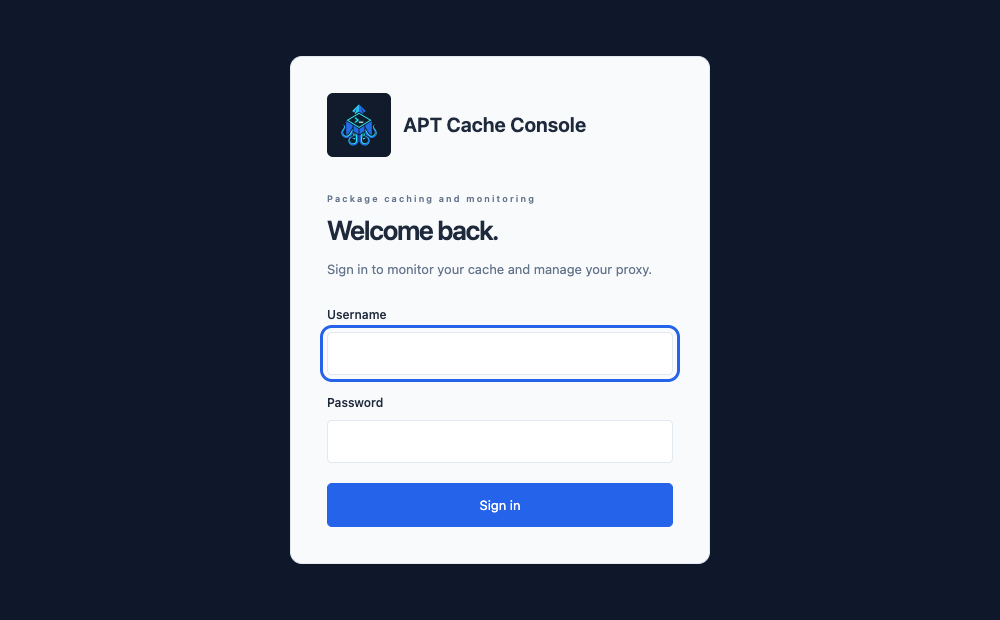
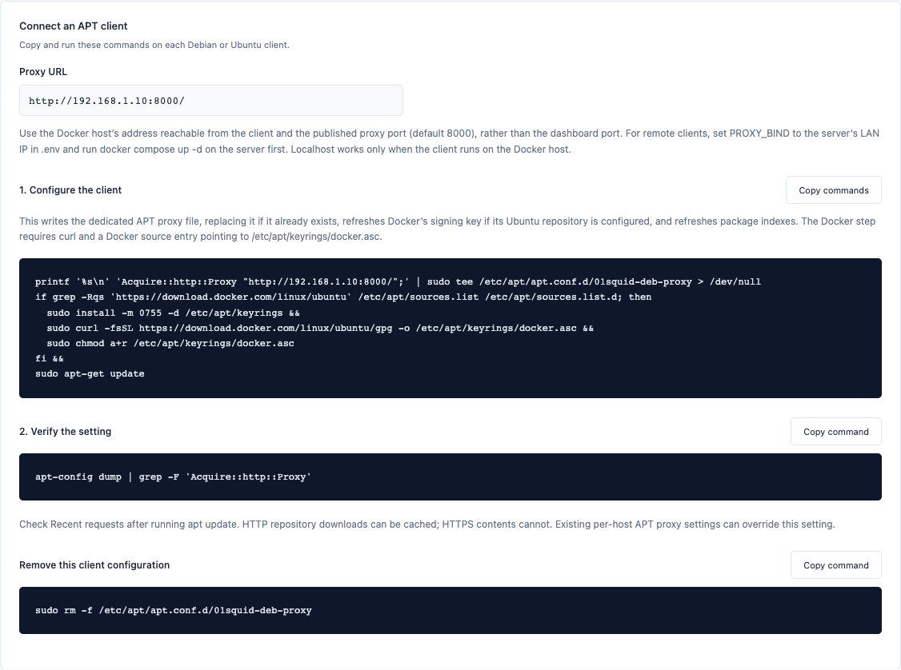

# APT Cache Console


APT Cache Console is a self-hosted dashboard for monitoring and managing an APT package cache. Docker Compose runs the dashboard and its caching proxy in **two separate containers**.

The proxy container uses Ubuntu’s `squid-deb-proxy` package and runs Squid with the settings in `proxy/squid.conf`.

## Screenshots

**Dashboard overview with sample traffic**



<details>
<summary>Sign-in screen</summary>



</details>

<details>
<summary>APT client setup</summary>



</details>

## Start

On Ubuntu or an Ubuntu-based server, requires Docker Engine with Compose v2 and `curl`.

```bash
cp .env.example .env
# Edit .env and set two different passwords. Manager password: 24–128
# letters, numbers, underscores or hyphens. UI password: at least 8 characters.
sh scripts/setup-server.sh
```

Server setup automatically downloads Docker’s official signing key and installs it at `/etc/apt/keyrings/docker.asc` **before** running `apt-get update`, then builds and starts both containers. It uses `sudo` when needed and can be rerun for updates. A failed or empty key download stops setup before APT or container startup and preserves the existing key. Docker repository entries must reference this path with `Signed-By`; see [Docker’s repository instructions](https://docs.docker.com/engine/install/ubuntu/#install-using-the-repository). On other hosts with Docker already configured, start the stack with `docker compose up -d --build`.

Open **http://<server-LAN-IP>:8080** from any device on your network, then use the login page to sign in with `UI_USERNAME` (default `admin`) and `UI_PASSWORD`. Use the configured `UI_PORT` if you changed it. On the Docker host, **http://localhost:8080** also works. Sessions expire after 12 hours or a UI restart; **Sign out** immediately revokes the current session. Sessions are held in memory by the single UI process, so no extra service or writable volume is needed.

Both published ports bind to all IPv4 interfaces (`0.0.0.0`) by default: the dashboard on `UI_PORT` (default `8080`) and the proxy on `PROXY_PORT` (default `8000`). To limit either service to one interface, set `UI_BIND` or `PROXY_BIND` in `.env` to the host's LAN IP; use `127.0.0.1` for host-only access. After changing bindings or ports, run `docker compose up -d` to recreate the affected services. Restrict these ports to your trusted network with your host firewall. Put the UI behind an HTTPS reverse proxy when needed to encrypt credentials and session cookies, and set `UI_COOKIE_SECURE=true` in `.env` for HTTPS-only cookies. Leave it false for direct HTTP access on your trusted LAN. Cookies are always HttpOnly and SameSite=Strict. API requests require the session cookie; HTTP Basic authentication is no longer accepted.

## Connect APT clients

For Ubuntu and Ubuntu-based clients, run the included setup script on each client. Replace the example URL with the Docker host’s reachable IP address or hostname and published proxy port.

```bash
sh scripts/configure-apt-proxy.sh http://192.168.1.10:8000/
```

The script checks the distribution, writes `/etc/apt/apt.conf.d/01squid-deb-proxy`, refreshes Docker’s signing key if its Ubuntu repository is configured, and runs `apt-get update`, using `sudo` when needed. Rerun it with the desired proxy URL to update the configuration.

The dashboard’s **Client setup** section generates these commands for your proxy URL and provides copy buttons. Run them on each Debian or Ubuntu **client**.

The proxy is reachable on the Docker host’s LAN IP and `PROXY_PORT` by default. Allow that port through the host firewall for your client network.

On the **client**, change the example address below to that reachable server IP or hostname and the published `PROXY_PORT` (default `8000`). Do not use the dashboard port, or `localhost` unless the client is the Docker host itself.

```bash
# Change this address to your proxy server before pasting.
printf '%s\n' 'Acquire::http::Proxy "http://192.168.1.10:8000/";' | sudo tee /etc/apt/apt.conf.d/01squid-deb-proxy > /dev/null
if grep -Rqs 'https://download.docker.com/linux/ubuntu' /etc/apt/sources.list /etc/apt/sources.list.d; then
  sudo install -m 0755 -d /etc/apt/keyrings &&
  sudo curl -fsSL https://download.docker.com/linux/ubuntu/gpg -o /etc/apt/keyrings/docker.asc &&
  sudo chmod a+r /etc/apt/keyrings/docker.asc
fi &&
sudo apt-get update
```

The Docker key step requires `curl` when that repository is configured. Its source entry must use `Signed-By: /etc/apt/keyrings/docker.asc` (or `signed-by=/etc/apt/keyrings/docker.asc` in a `.list` entry). If it references another keyring, update that existing entry to this path. See [Docker’s repository instructions](https://docs.docker.com/engine/install/ubuntu/#install-using-the-repository).

This creates the dedicated proxy configuration file, replacing it if present. Confirm APT loaded it:

```bash
apt-config dump | grep -F 'Acquire::http::Proxy'
```

The output should contain your chosen proxy URL. Check **Recent requests** in the dashboard after `apt-get update`. Existing per-host APT proxy settings can override this global setting.

To download a package for a cache test without installing it:

```bash
mkdir -p ~/squid-proxy-test
cd ~/squid-proxy-test
apt-get download hello
```

Repeat the download on a second client to observe cache hits. The package must be available in that client's configured repositories, and its repository must use HTTP to cache the contents. The download test writes a `.deb` into `~/squid-proxy-test`.

To remove this proxy configuration from a client:

```bash
sudo rm -f /etc/apt/apt.conf.d/01squid-deb-proxy
```

HTTP package downloads can be cached. HTTPS tunnels are allowed for listed mirrors but their contents cannot be cached; this project does not intercept TLS. Automatic Avahi discovery is not configured.

## Dashboard

- Lifetime requests, request hit ratio, and bytes delivered from Squid's live cache manager.
- Sampled last-hour traffic, cached-response bytes, HTTP errors, client counts, and repository activity from the shared access log.
- Latest 100 requests with filtering. URL credentials, query strings, and fragments are removed before sending data to the browser.
- Read-only diagnostic reports: general info, counters, five-minute averages, utilization, and cache storage.
- A repository mirror editor with hostname validation, stale-edit protection, persistent storage, and automatic reload requests.
- A confirmed configuration reload request. No Docker socket or host process control is exposed to the UI.

The dashboard polls every 10 seconds while visible. Offline Squid and unreadable logs are shown explicitly. Log-based statistics inspect at most the latest **2 MB of the current log**, exclude cache-manager requests, and are not durable historical analytics. Busy proxies and rotated logs can therefore yield a partial last hour. Lifetime counters reset when Squid restarts and include manager traffic; sampled activity excludes it. Bytes from cache hits (including revalidated responses) are an estimate of cache reuse, not an exact upstream-bandwidth saving.

## Mirrors and configuration

Use **Allowed mirrors** in the dashboard to add or remove repository hostnames, then choose **Save & apply**. Enter one hostname per line, such as `download.docker.com`. Prefix a domain with `.` to include its subdomains (`.ubuntu.com`). URLs, paths, ports, IP addresses, and wildcards are rejected. The list must contain 1–200 entries. Removing a host blocks future requests to that repository.

The UI validates hostnames, saves the list atomically, and requests a Squid reload. If the manager request fails, it restores the previous file and attempts a recovery reload; check diagnostics before retrying. A stale browser editor cannot overwrite a newer saved version: choose **Reload list** to load the latest list (this discards unsaved edits).

Changes live in the `proxy-mirrors` Docker volume and survive restarts and image rebuilds. On first startup only, the proxy seeds this volume from `proxy/mirrors.acl`, preserving your existing initial allowlist. Later edits to that seed file do not replace the dashboard-managed list. Back up this volume along with your other persistent data; `docker compose down -v` deletes it.

**Upgrading an existing deployment:** run `docker compose up -d --build` once to rebuild both services and attach the shared mirror volume. Your current seed allowlist is imported automatically if the volume is new. The UI runs as UID 10001 with write access to the mirror volume; it still has no Docker socket or permission to change other Squid settings.

For changes to other proxy configuration files, validate and reload manually:

```bash
docker compose exec squid-deb-proxy squid -f /etc/squid-deb-proxy/ui-squid.conf -k parse >/dev/null 2>&1
docker compose exec squid-deb-proxy squid -f /etc/squid-deb-proxy/ui-squid.conf -k reconfigure
```

General Squid settings live in `proxy/squid.conf`. The disk cache defaults to **10,000 MB**, memory cache to **128 MB**, and the maximum cached object to **1,024 MB**. Rebuild the proxy container after changing this template. The default mirror allowlist includes Debian, Ubuntu, Canonical, Launchpad, and Docker's package repository (`download.docker.com`).

Manager HTTP access listens on port 8001 **inside the Docker network only**. Port 8000 explicitly denies manager requests. Manager calls require the shared manager password; dashboard users do not receive it. The API allows only named reports and one reload action. Do not attach untrusted containers to this network.

## Operations

```bash
docker compose logs -f
docker compose ps
# Rotate access/cache logs periodically (for example from host scheduling):
docker compose exec squid-deb-proxy squid -f /etc/squid-deb-proxy/ui-squid.conf -k rotate
# Restart both services:
docker compose restart
# Stop services, retaining cache and logs:
docker compose down
```

Named volumes persist the proxy cache and logs. `docker compose down -v` deletes both. Log rotation retains five files and should be scheduled for long-running installations; dashboard statistics read only the current file. The UI runs as an unprivileged user with a read-only filesystem and read-only log volume. `/healthz` checks the UI process; Compose independently checks the proxy listener. Proxy failures remain visible in the dashboard.

The overview's **Cache disk usage** card shows Squid's reported disk cache size and percentage of its configured cache limit, refreshed every 10 seconds. This measures cached objects, excluding logs, container images, filesystem overhead, and other host disk usage. Storage data appears as unavailable if the cache manager cannot provide it. The totals come from Squid's [storedir report](https://github.com/squid-cache/squid/blob/master/src/store/Controller.cc).

## Development

Development uses Python 3.15 and `uv` 0.13 or newer. `uv sync` installs the pinned Python version if needed:

```bash
uv sync --group dev
uv run python -m pytest
uv run ty check
uv run ruff check app tests
uv run ruff format --check app tests
node --check app/static/app.js
node --test tests/*.test.mjs
```

To run plain `pytest` from `tests/`, activate the project environment first with `source ../.venv/bin/activate`.

Ruff checks Google-style docstrings and requires parameter and return annotations. ty checks the application and tests against the project's minimum Python version.

For local API/UI development, export `UI_PASSWORD`, `SQUID_MANAGER_PASSWORD`, `SQUID_HOST`, `SQUID_PORT`, and optionally `ACCESS_LOG`, then run `uv run uvicorn app.main:app --host 127.0.0.1 --port 8080`. An unreachable proxy renders an explicit offline state; no demo statistics are substituted. The frontend uses native HTML, CSS, and JavaScript, so there is no Node build or CDN dependency.

## References

- [squid-deb-proxy upstream](https://github.com/mvo5/squid-deb-proxy)
- [Squid HTTP cache manager](https://wiki.squid-cache.org/Features/CacheManager/Index)
